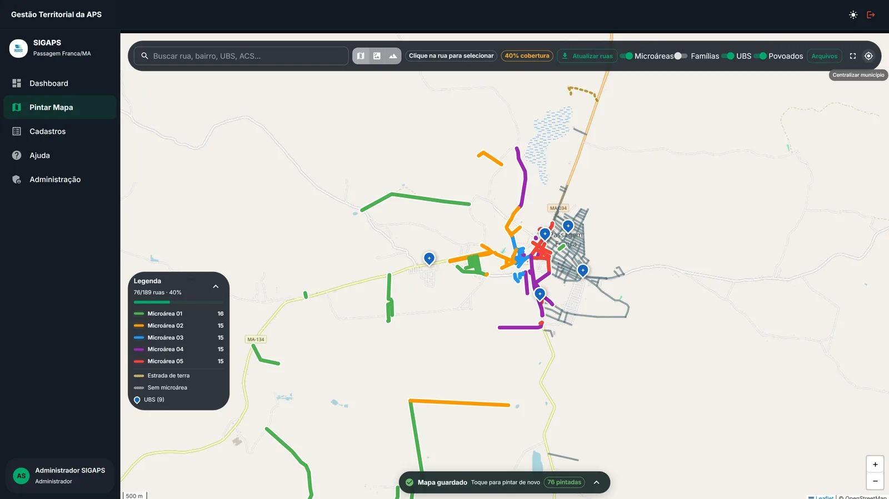
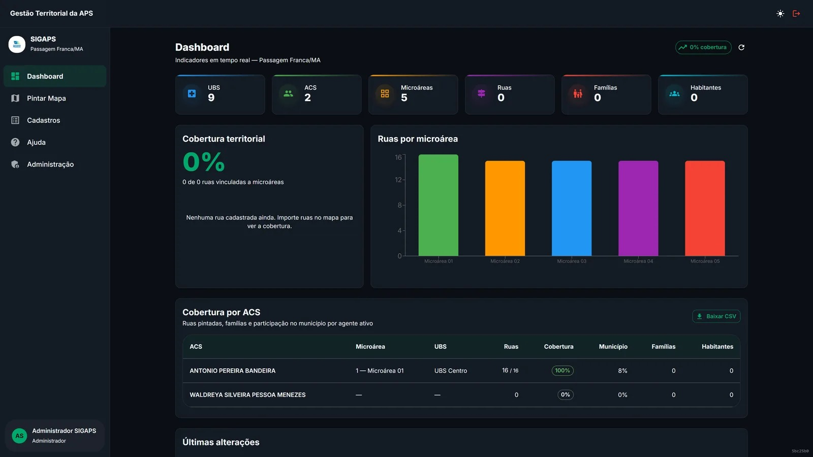
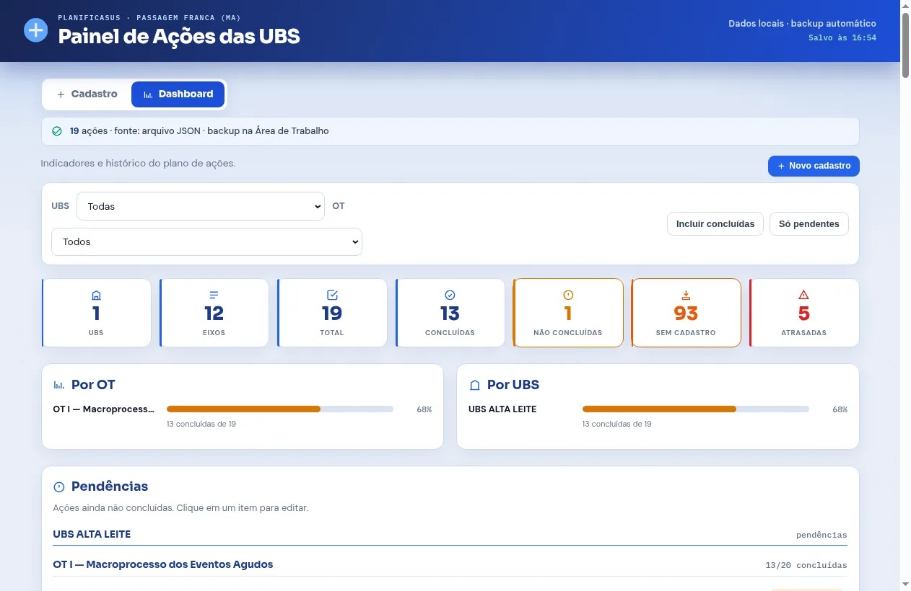
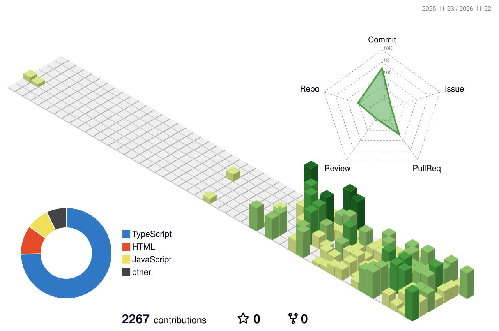

  
  
  

Sou o Yuri, estou no 6º período de Ciência da Computação e trabalho com TI. Nos últimos dois anos
entreguei sistemas que estão rodando de verdade: um mapa das microáreas de saúde para uma prefeitura
do Maranhão e um painel que as UBS de lá usam no dia a dia para acompanhar o plano de ações.

Gosto de problema concreto: mapa com PostGIS, app que precisa funcionar sem internet no interior,
automação que tira trabalho repetido de alguém. Uso IA no dia a dia, mas quem responde pela regra
de negócio e pela entrega sou eu.

Estou aberto a **vaga júnior ou estágio remoto** e pego **projetos freelance**.

 

## Trabalhos

### [SIGAPS](https://github.com/ymedeiros228/sigaps) &nbsp;·&nbsp; gestão territorial da Atenção Primária

A equipe da prefeitura "pinta" no mapa as ruas de cada agente de saúde e vê na hora a cobertura
do município. Atende vários municípios no mesmo sistema com os dados separados, login por perfil e
dados pessoais mascarados.

  
  

`React` `NestJS` `Prisma` `PostgreSQL/PostGIS` `Docker` `GitHub Actions` &nbsp;·&nbsp; [demo ao vivo](https://sigaps-api.onrender.com)

### [Painel UBS Planifica](https://github.com/ymedeiros228/painel-ubs-planifica) &nbsp;·&nbsp; em uso nas UBS de Passagem Franca/MA

App de Windows para o PlanificaSUS: cadastro das ações de cada UBS, painel com o que está atrasado
e backup automático. Roda sem internet e sem instalar, porque nem todo posto tem rede boa.

`Electron` `JavaScript` &nbsp;·&nbsp; [baixar](https://github.com/ymedeiros228/painel-ubs-planifica/releases/latest)

### [AgroNexus](https://github.com/ymedeiros228/agronexus) &nbsp;·&nbsp; app de campo para agrônomos

Visita técnica, contagem de estande, talhão desenhado com GPS ou importado de KML, insumos e
financeiro da safra. Funciona offline e sincroniza quando o sinal volta. 173 testes.

`Next.js` `Dexie (IndexedDB)` `Supabase` `PWA`

### [MathHub](https://github.com/ymedeiros228/mathhub-plataforma) &nbsp;·&nbsp; plataforma de cursos

Áreas de aluno, professor e admin, assinatura, simulados e fila de dúvidas.

`Next.js` `TypeScript` `Prisma` `PostgreSQL`

outros projetos

 

- [Verde Urbano](https://github.com/ymedeiros228/verde-urbano): mapeamento da arborização de Teresina (Next.js, MapLibre, Supabase)
- **Portal Prefeituras** (código privado): site, transparência no padrão PNTP e painel admin para prefeituras pequenas
- [Chatbot de atendimento](https://github.com/ymedeiros228/chatbot-ia-n8n-customer-success): n8n, Google Sheets e IA
- [Ensemble](https://github.com/ymedeiros228/ensemble): app de organização para estudantes
- [Portfolio Universe](https://github.com/ymedeiros228/portfolio-universo-yuri): meu portfólio em Three.js
- Contribuição open source: [PR #45 no Nothe](https://github.com/7Cass/nothe/pull/45)

 

## Ferramentas

  

<picture>
  <source media="(prefers-color-scheme: dark)" srcset="profile-3d-contrib/profile-night-green.svg" />
  
</picture>

<picture>
  <source media="(prefers-color-scheme: dark)" srcset="https://raw.githubusercontent.com/ymedeiros228/ymedeiros228/output/github-snake-dark.svg" />
  
</picture>
