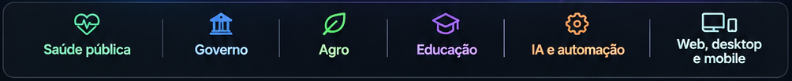
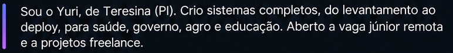
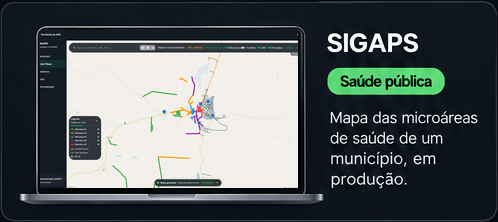
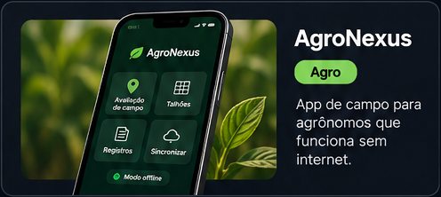
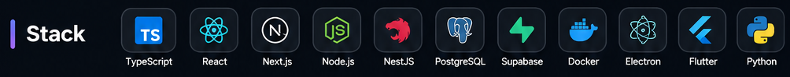

&nbsp;
&nbsp;

  

 

 

<picture>
  <source media="(prefers-color-scheme: dark)" srcset="https://raw.githubusercontent.com/ymedeiros228/ymedeiros228/output/github-snake-dark.svg" />
  
</picture>

