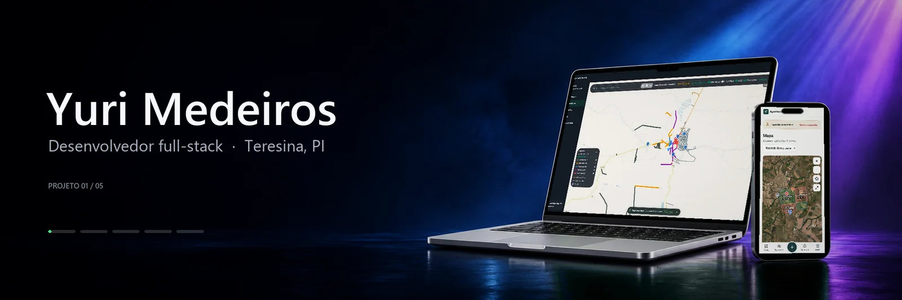

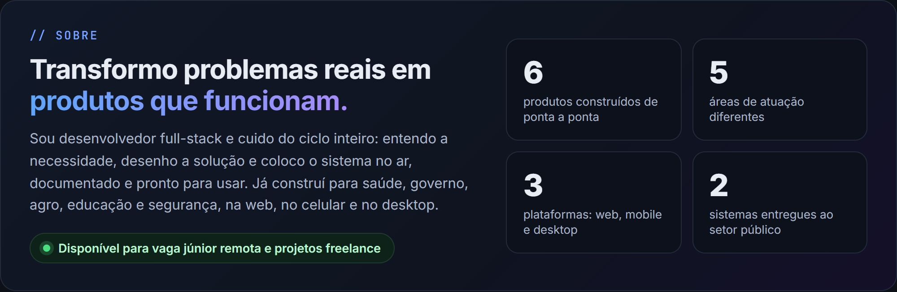

&nbsp;
<a href="https://portfolio-universo-yuri.vercel.app">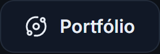</a>

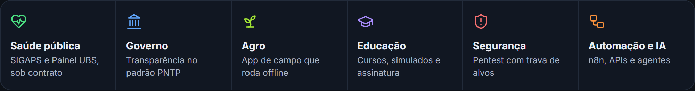

<a href="https://github.com/ymedeiros228/sigaps">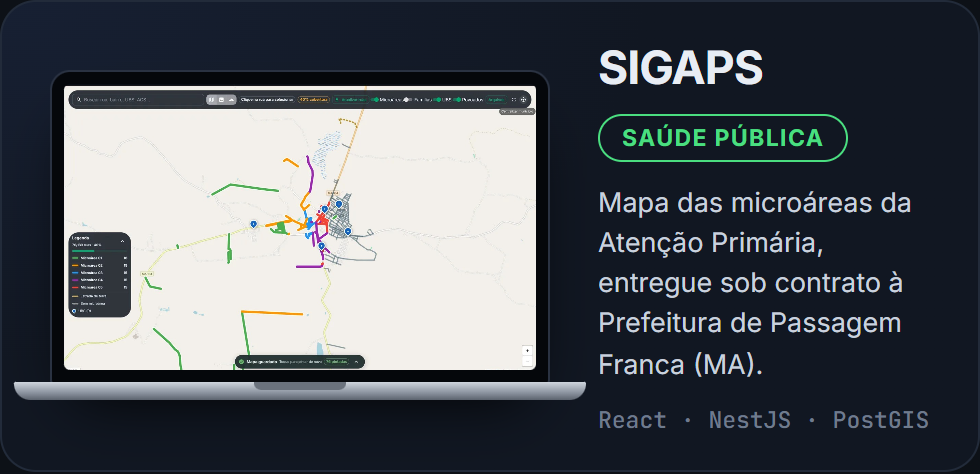</a>
<a href="https://github.com/ymedeiros228/agronexus">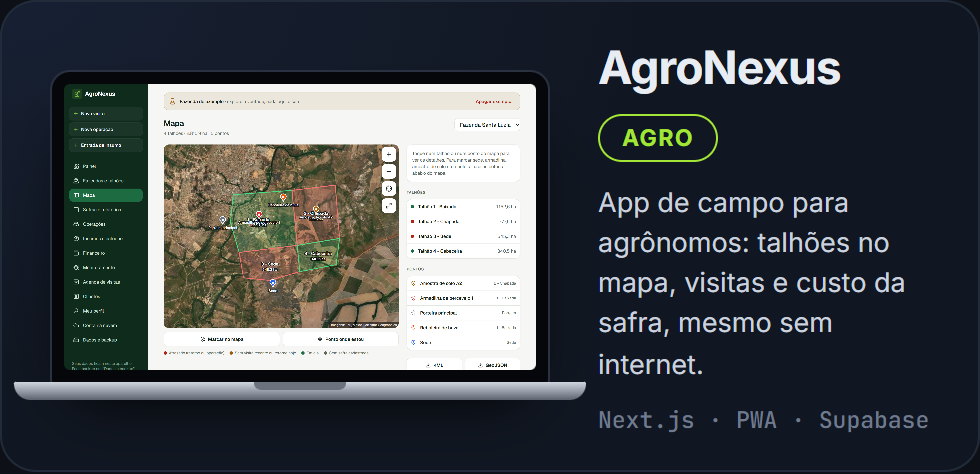</a>
<a href="https://github.com/ymedeiros228/mathhub-vitrine">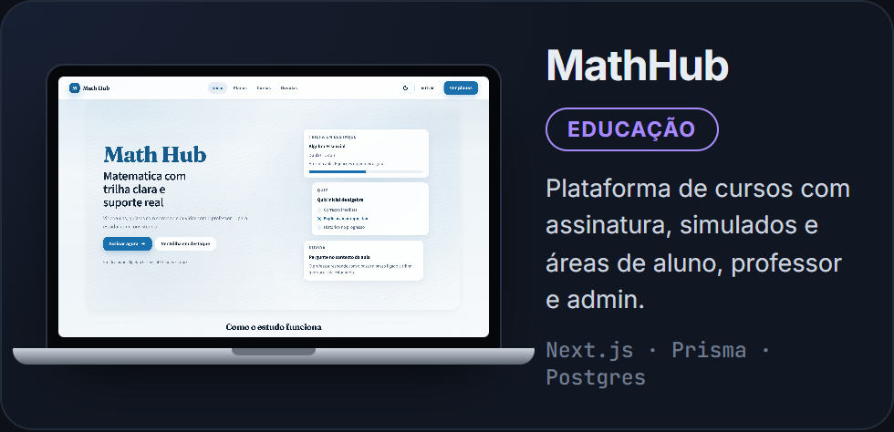</a>
<a href="https://github.com/ymedeiros228/portal-prefeituras-vitrine">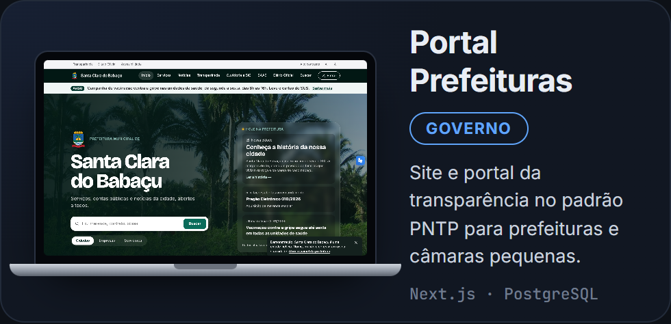</a>
<a href="https://github.com/ymedeiros228/verde-urbano">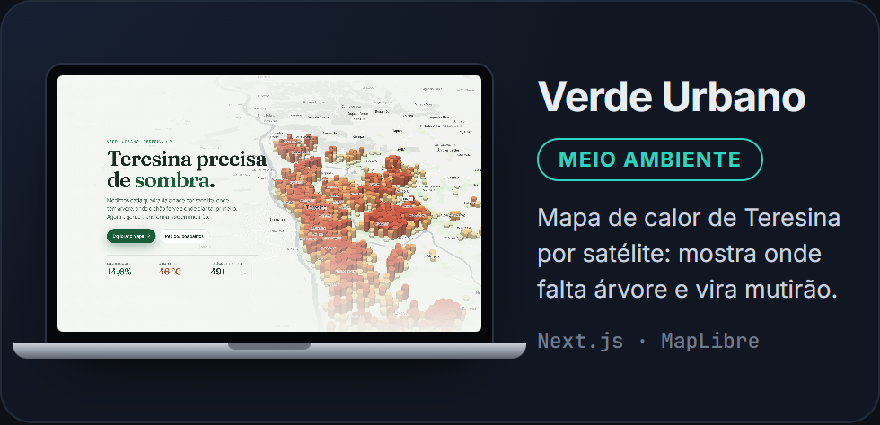</a>
<a href="https://github.com/ymedeiros228/harpia-vitrine">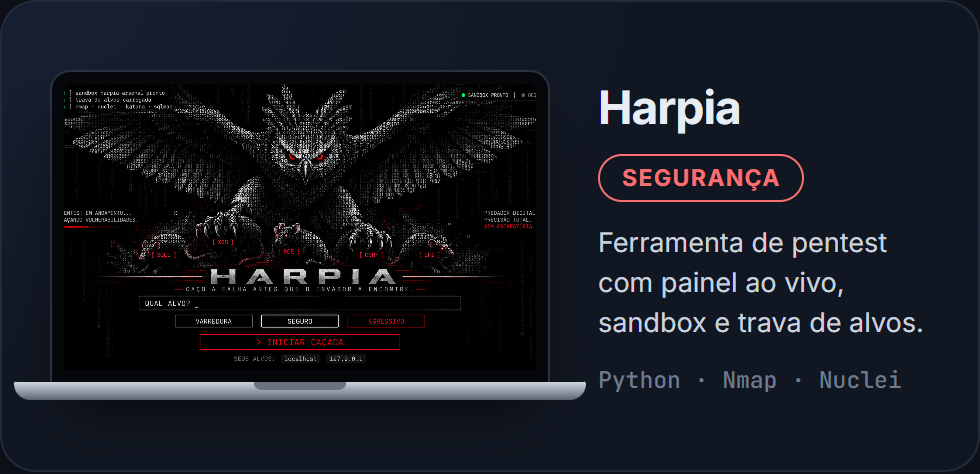</a>

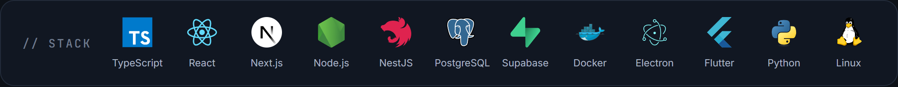

<picture>
  <source media="(prefers-color-scheme: dark)" srcset="https://raw.githubusercontent.com/ymedeiros228/ymedeiros228/output/github-snake-dark.svg" />
  
</picture>
